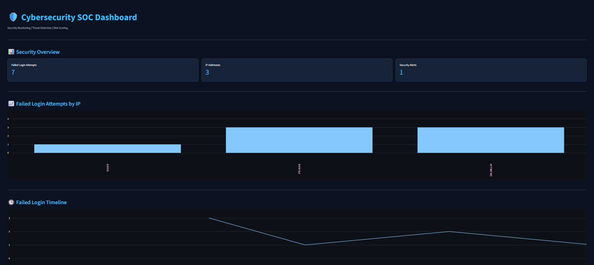

# Cybersecurity Log Analyzer

A Python-based cybersecurity project designed to analyze authentication logs, detect suspicious login attempts, and manage security alerts through an interactive SOC dashboard.

This project was developed to practice Python programming, defensive cybersecurity, log analysis, and security monitoring.

## Live Demo

Try the application here:

https://y7aseer-cybersecurity.streamlit.app/

## Dashboard Preview



## Features

### Security Log Analysis
- Reads authentication log files.
- Identifies failed login attempts.
- Extracts timestamps and IP addresses.
- Organizes login activity for security analysis.

### Brute Force Detection
- Detects repeated failed login attempts from the same IP address.
- Uses a detection threshold of 3 failed attempts within 60 seconds.
- Generates alerts when suspicious activity is detected.

### IP Risk Assessment
- Calculates risk scores based on failed login behavior.
- Assigns risk levels to IP addresses.
- Helps identify IP addresses that require investigation.

### SOC Dashboard
- Displays security monitoring metrics.
- Shows detected security alerts.
- Displays IP risk assessments in a table.
- Supports filtering by IP address.
- Allows users to upload security log files.

### Automatic Monitoring
- Supports refresh intervals of 5, 10, 30, and 60 seconds.
- Allows monitoring to be paused or resumed.
- Automatically reanalyzes available log data.

### Alert Management
- Stores detected alerts in SQLite.
- Allows users to acknowledge security alerts.
- Tracks new and acknowledged alerts.
- Maintains persistent alert history.

### Report Export
- Exports detected alerts in JSON format.
- Exports IP risk assessment reports in CSV format.

### Automated Testing
- Includes 21 unit tests.
- Uses Python's built-in unittest framework.

## Technologies Used

- Python
- Streamlit
- Pandas
- SQLite
- Unittest
- Git and GitHub
- Streamlit Community Cloud

## Project Structure

```text
cybersecurity-log-analyzer/
├── main.py
├── detector.py
├── threat_intelligence.py
├── report_export.py
├── dashboard.py
├── database.py
├── security.log
├── requirements.txt
├── README.md
└── screenshots/
    └── dashboard.png
```

## Installation

### 1. Clone the Repository

```bash
git clone https://github.com/y7aseer/cybersecurity-log-analyzer.git
cd cybersecurity-log-analyzer
```

### 2. Install Dependencies

```bash
python -m pip install -r requirements.txt
```

### 3. Run the Dashboard

```bash
python -m streamlit run dashboard.py
```

Open the application at:

http://localhost:8501

## Example Security Logs

```text
2026-10-08 10:00:01 | FAILED | 192.168.1.100
2026-10-08 10:00:10 | FAILED | 192.168.1.100
2026-10-08 10:00:20 | FAILED | 192.168.1.100
```

## How It Works

1. The application reads authentication logs.
2. Failed login attempts are extracted.
3. Login activity is analyzed for suspicious patterns.
4. Potential brute-force attacks are detected.
5. IP risk scores are calculated.
6. Security alerts are generated and stored.
7. Results are displayed in the SOC dashboard.
8. Users can acknowledge alerts and export reports.

## Running Tests

Run the automated tests using:

```bash
python -m unittest discover -v
```

The project includes 21 unit tests covering core security analysis functionality.

## Deployment

The application is deployed using Streamlit Community Cloud.

Live Application:

https://y7aseer-cybersecurity.streamlit.app/

## Limitations

- The project uses rule-based threat detection.
- Risk scores are based on authentication log behavior rather than external threat intelligence.
- The application does not automatically block suspicious IP addresses.
- SQLite data on Streamlit Community Cloud may be lost after restarts or redeployments.
- The hosted application is intended for demonstration and should only be used with synthetic logs.
- This is an educational security monitoring project, not a production SIEM system.

## Skills Demonstrated

- Python Programming
- Cybersecurity Fundamentals
- Security Log Analysis
- Brute Force Detection
- Threat Detection
- IP Risk Assessment
- SQLite Database Integration
- Security Alert Management
- Automated Testing
- Git and GitHub
- Cloud Deployment

## Author

Developed by [@y7aseer](https://github.com/y7aseer)

GitHub Repository:

https://github.com/y7aseer/cybersecurity-log-analyzer

Live Demo:

https://y7aseer-cybersecurity.streamlit.app/
